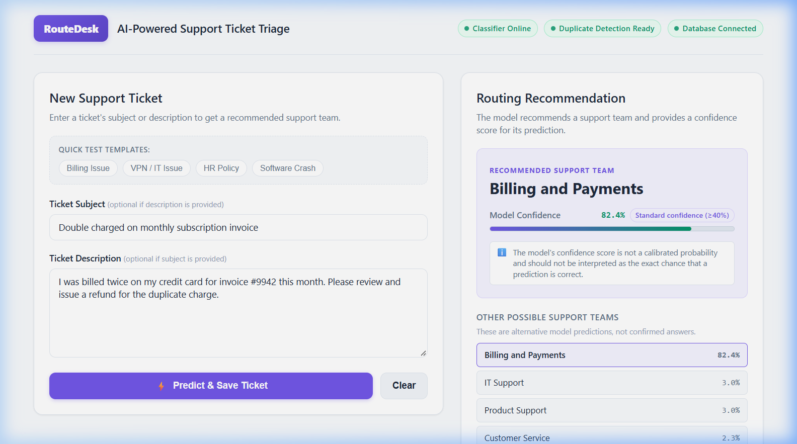
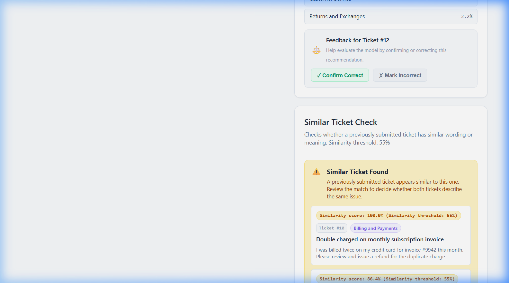
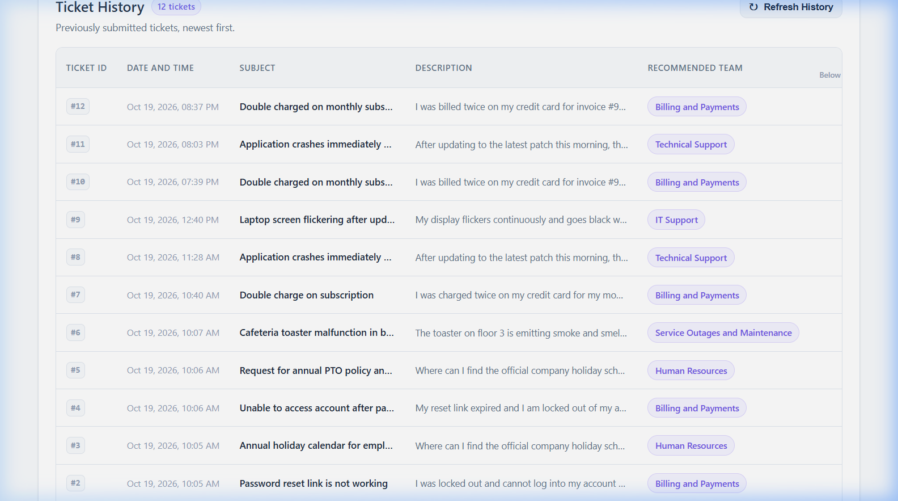
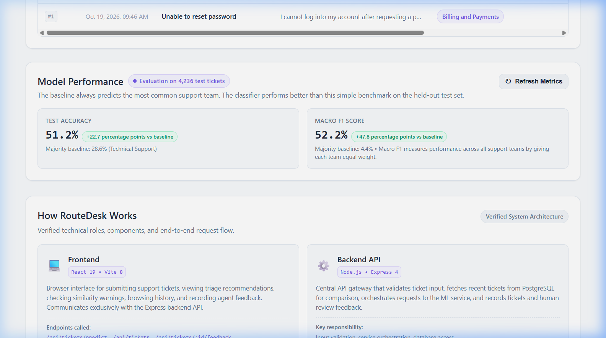

# RouteDesk — AI-Powered Support Ticket Triage System

RouteDesk is a full-stack, three-tier software engineering system designed for intelligent support ticket triage. It combines a React frontend, a Node.js/Express API gateway, and a Python/FastAPI machine learning engine backed by Supabase PostgreSQL.

The system automatically classifies incoming support tickets into 10 department queues using a trained classification pipeline, computes dense semantic embeddings to detect potential duplicate inquiries in real time, archives ticket submissions, and provides a structured human-in-the-loop feedback mechanism for triage auditability and model evaluation.

---

## Key Features

- **Automated Queue Classification:** Categorizes tickets into 10 target departments (`Billing and Payments`, `Customer Service`, `General Inquiry`, `Human Resources`, `IT Support`, `Product Support`, `Returns and Exchanges`, `Sales and Pre-Sales`, `Service Outages and Maintenance`, `Technical Support`).
- **Explainable Predictions & Alternative Queues:** Displays the top-ranked department queue, an estimated confidence percentage, and the next 4 most probable alternative queues to assist human decision-making.
- **Low-Confidence Warning Flag:** Highlights ambiguous predictions with an operational review flag when model confidence is below 40%, signaling that human verification is recommended.
- **Semantic Duplicate Detection:** Encodes ticket text using dense sentence embeddings (`all-MiniLM-L6-v2`) and computes cosine similarity against historical tickets in the database. When similarity meets or exceeds the configured 55% threshold, potential duplicates are presented to human agents without altering routing or auto-rejecting.
- **Persistent Ticket History & Feedback Loop:** Persists tickets in PostgreSQL and provides agents with one-click verification (`✓ Correct`) or departmental reassignment (`✗ Reassign`). Feedback is stored in an audit table with database-level uniqueness and consistency constraints.
- **Live Service Observability:** Features real-time status indicators in the dashboard header that monitor connectivity to the Express backend, FastAPI ML service, and Supabase database.
- **Transparent Model Evaluation Metrics:** Dynamically surfaces verified test set metrics (accuracy, macro F1, majority-class baselines) and class confusion characteristics directly in the interface.

---

## Application Screenshots

### 1. Main Dashboard & Ticket Submission
The primary operational view includes real-time service health indicators, ticket input fields (subject and body), and pre-populated test templates for quick evaluation.



### 2. Routing Recommendation & Duplicate Check
Upon submission, the dashboard displays the predicted queue, confidence rating, low-confidence warning (when applicable), alternative candidate queues, feedback action buttons, and semantic duplicate check results with similarity scores.



### 3. Ticket History & Human Feedback
The historical log displays all persisted tickets with timestamp, predicted department, confidence pill, and human feedback status (`Correct` or `Reassigned`).



### 4. Model Performance & System Architecture
A dedicated evaluation and architecture panel presents verified model metrics against majority-class baselines alongside an architectural breakdown of the request pipeline.



---

## How RouteDesk Works

RouteDesk implements a synchronous triage and archival flow coordinated through the Express API gateway:

```
[ User / Browser ]
       │
       │ 1. POST /api/tickets/predict (subject, body)
       ▼
[ Node.js / Express Gateway (Port 4000) ]
       │
       ├─► 2a. POST /predict ──────────────► [ FastAPI ML Service (Port 8000) ]
       │       Returns: predicted queue,        (TF-IDF + Logistic Regression)
       │       confidence, probabilities
       │
       ├─► 2b. Fetch historical tickets ───► [ Supabase PostgreSQL ]
       │       Returns: candidate tickets
       │
       ├─► 2c. POST /duplicates ───────────► [ FastAPI ML Service (Port 8000) ]
       │       Returns: duplicate matches       (Sentence-Transformers all-MiniLM-L6-v2)
       │       exceeding 0.55 similarity
       │
       ├─► 3. INSERT INTO public.tickets ──► [ Supabase PostgreSQL ]
       │      Persists ticket and prediction
       ▼
[ Response to Frontend (Port 5173) ]
Displays recommendation, alternative queues, duplicate warnings, and updates ticket table.
       │
       │ 4. Optional Agent Feedback: POST /api/tickets/:id/feedback
       ▼
[ Supabase PostgreSQL (public.ticket_feedback) ]
Stores human validation or reassignment for auditability.
```

### Request Flow Stages:

1. **Ticket Submission:** The user enters a ticket subject and description in the React frontend and clicks "Submit & Route". The frontend issues a `POST /api/tickets/predict` request to the Express backend gateway.
2. **Dual-Stage ML Processing:**
   - **Queue Classification:** Express forwards the text payload to FastAPI (`POST /predict`), where the serialized `TfidfVectorizer` and `LogisticRegression` pipeline calculates class probabilities across all 10 departments.
   - **Duplicate Analysis:** Express retrieves existing tickets from the database and forwards them alongside the submitted ticket to FastAPI (`POST /duplicates`). The ML service generates 384-dimensional dense embeddings using `all-MiniLM-L6-v2` and computes pairwise cosine similarity against candidates.
3. **Database Archival:** Upon receiving predictions and similarity scores, Express writes the ticket record (`subject`, `body`, `predicted_queue`, `confidence`) into `public.tickets` in Supabase PostgreSQL.
4. **Interactive Dashboard & Feedback:** The frontend receives the unified response and displays the routing recommendation, alternative queues, and duplicate warnings. Support agents can review historical tickets and submit feedback (`POST /api/tickets/:id/feedback`), which is written to `public.ticket_feedback` without modifying the trained model weights.

---

## Technology Stack

| Layer | Component | Version / Tools | Role in RouteDesk |
|---|---|---|---|
| **Frontend** | React | 19.x | Component architecture, application state, and form interactions |
| **Build & Dev** | Vite | 6.x | Fast local development server (port 5173) and production bundling |
| **Styling** | Vanilla CSS | Custom CSS | Clean, responsive design system with dark modern aesthetic and flexbox/grid layouts |
| **Icons** | Lucide React | Latest | Functional icons for status, metrics, and actions |
| **API Gateway** | Node.js / Express | Node 20+, Express 4.x | REST API routing, request validation, orchestration between ML service and database (port 4000) |
| **Database Client**| `@supabase/supabase-js` | 2.x | Secure server-side PostgreSQL queries and connection management |
| **ML Inference** | FastAPI / Uvicorn | FastAPI 0.115+, Uvicorn 0.34+ | Asynchronous REST endpoints for classification, embeddings, and metrics (port 8000) |
| **Text Classifier** | Scikit-Learn | 1.6+ | TF-IDF feature extraction and multinomial Logistic Regression pipeline |
| **Semantic Embeddings** | Sentence-Transformers | 3.4+ (`all-MiniLM-L6-v2`) | Dense vector embeddings and cosine similarity calculation for duplicate detection |
| **Database** | PostgreSQL | Supabase Cloud | Managed relational database hosting `public.tickets` and `public.ticket_feedback` tables |

---

## Machine-Learning Approach and Duplicate-Ticket Detection

### 1. Queue Classification Pipeline

The classification model is implemented as a Scikit-Learn `Pipeline` serialized in `ml-service/artifacts/tfidf_lr_pipeline.joblib`:
- **Text Vectorization:** `TfidfVectorizer` configured with sublinear term-frequency scaling (`sublinear_tf=True`), document frequency filtering (`min_df=3`, `max_df=0.9`), and unigram plus bigram extraction (`ngram_range=(1, 2)`).
- **Classifier:** `LogisticRegression` with balanced class weights (`class_weight='balanced'`) to handle class imbalance, regularization parameter `C=1.0`, and `max_iter=1000`.
- **Target Taxonomy:** 10 customer support categories defined statically in `ml-service/artifacts/classes.json`.
- **Input Flexibility:** Accepts combined `subject` and `body` text, or either field individually.

### 2. Semantic Duplicate Detection

Duplicate detection operates independently from queue classification:
- **Embedding Model:** `sentence-transformers/all-MiniLM-L6-v2`, mapping ticket text into 384-dimensional dense vector space.
- **Similarity Metric:** Pairwise cosine similarity between the incoming ticket embedding and candidate embeddings from existing database records.
- **Configured Threshold:** `0.55` (55% similarity cutoff). Tickets matching or exceeding this score are flagged as potential duplicates.
- **Human Decision Support:** Similar-ticket detection provides suggestions for human review. RouteDesk does not automatically reject, alter, or merge tickets.

### 3. Model Confidence Interpretation

- Confidence values reflect normalized softmax outputs across learned n-gram features.
- **Model confidence is not a calibrated Bayesian probability.** It should not be interpreted as the exact probability that a prediction is objectively correct.
- An operational heuristic is applied in the interface: predictions with confidence below 40% are highlighted with a "Review Recommended" warning to prioritize manual verification.

---

## Model Evaluation Results

Model performance was evaluated on a held-out test split of the `Tobi-Bueck/customer-support-tickets` dataset. Data partitioning was executed using a stratified group split grouped by normalized ticket text (`ticket_text_norm`), guaranteeing zero duplicate text leakage across splits.

### Dataset Partitioning

| Partition | Ticket Count | Percentage |
|---|---|---|
| **Training Set** | 19,786 | 70.0% |
| **Validation Set** | 4,241 | 15.0% |
| **Test Set (Held-Out)** | 4,236 | 15.0% |
| **Total Corpus** | **28,263** | 100.0% |

### Test Set Performance vs. Majority Baseline

Evaluation metrics are loaded directly from the saved training artifact (`ml-service/artifacts/metrics.json`):

| Evaluation Metric | RouteDesk Model (Logistic Regression) | Majority-Class Baseline | Absolute Improvement |
|---|---|---|---|
| **Test Accuracy** | **51.2%** (`0.512276`) | 28.6% (`0.285647`) | **+22.7 percentage points** |
| **Macro F1 Score** | **52.2%** (`0.522256`) | 4.4% (`0.044436`) | **+47.8 percentage points** |
| **Weighted F1 Score** | **51.3%** (`0.512534`) | 12.7% (`0.127263`) | **+38.5 percentage points** |

### Per-Class Performance Summary

| Support Queue | Test Samples | Precision | Recall | F1 Score |
|---|---|---|---|---|
| **Billing and Payments** | 1,209 | 0.691 | 0.785 | **0.735** |
| **Customer Service** | 185 | 0.448 | 0.465 | 0.456 |
| **General Inquiry** | 163 | 0.435 | 0.509 | 0.469 |
| **Human Resources** | 321 | 0.655 | 0.688 | **0.672** |
| **IT Support** | 563 | 0.439 | 0.451 | 0.445 |
| **Product Support** | 473 | 0.395 | 0.442 | 0.417 |
| **Returns and Exchanges** | 403 | 0.638 | 0.591 | **0.613** |
| **Sales and Pre-Sales** | 204 | 0.478 | 0.490 | 0.484 |
| **Service Outages and Maintenance** | 208 | 0.536 | 0.481 | 0.507 |
| **Technical Support** | 507 | 0.407 | 0.448 | 0.427 |

*Note: Evaluation results reflect the characteristics of the synthetic benchmark corpus and serve as a comparative baseline rather than a guarantee of real-world production accuracy.*

---

## Project Structure

```
RouteDesk/
├── frontend/                     # React + Vite application (Port 5173)
│   ├── src/
│   │   ├── App.jsx               # Main dashboard component and state management
│   │   ├── App.css               # Core dashboard stylesheet and design system
│   │   ├── index.css             # Base reset and typography styles
│   │   └── main.jsx              # Application entry point
│   ├── .env.example              # Frontend environment template
│   └── package.json              # Frontend dependencies and scripts
│
├── backend/                      # Node.js + Express API gateway (Port 4000)
│   ├── src/
│   │   ├── index.js              # Express app initialization, CORS, and middleware
│   │   ├── supabase.js           # Supabase client instantiation
│   │   └── routes/
│   │       └── tickets.js        # Ticket predict, duplicate, history, and feedback routes
│   ├── test_feedback.js          # Feedback route automated test script
│   ├── .env.example              # Backend environment template
│   └── package.json              # Backend dependencies and scripts
│
├── ml-service/                   # Python + FastAPI ML inference service (Port 8000)
│   ├── app/
│   │   ├── __init__.py
│   │   └── main.py               # FastAPI app, endpoints (/health, /predict, /duplicates, /metrics)
│   ├── artifacts/
│   │   ├── metrics.json          # Frozen test set evaluation metrics
│   │   ├── classes.json          # 10 target department labels
│   │   ├── confusion_matrix.csv  # Confusion matrix data from model evaluation
│   │   └── tfidf_lr_pipeline.joblib # Serialized scikit-learn pipeline (local artifact)
│   ├── test_api.py               # Comprehensive ML API endpoint test suite
│   ├── test_duplicates.py        # Semantic duplicate detection test suite
│   ├── train.py                  # Model training and artifact generation script
│   ├── requirements.txt          # Inference runtime dependencies
│   ├── requirements-train.txt    # Training pipeline dependencies
│   └── .env.example              # ML service environment template
│
└── docs/
    └── screenshots/              # Application screenshots for documentation
        ├── 01-dashboard-submission.png
        ├── 02-routing-and-similarity.png
        ├── 03-ticket-history-feedback.png
        └── 04-model-performance-architecture.png
```

---

## Prerequisites

Before setting up RouteDesk, verify that your environment has the following software installed:

- **Node.js:** `v20.0.0` or higher
- **npm:** `v9.0.0` or higher
- **Python:** `v3.11.0` or higher
- **Supabase Account:** Access to a Supabase project or a local PostgreSQL instance

---

## Setup and Installation

### 1. Clone Repository & Prepare Environments

```bash
git clone <repository-url>
cd RouteDesk
```

Create `.env` configuration files from their respective templates:

```bash
# Frontend
cp frontend/.env.example frontend/.env

# Backend
cp backend/.env.example backend/.env

# ML Service
cp ml-service/.env.example ml-service/.env
```

### 2. Frontend Setup

```bash
cd frontend
npm install
cd ..
```

### 3. Backend Setup

```bash
cd backend
npm install
cd ..
```

### 4. ML Service Setup

```bash
cd ml-service

# Create and activate Python virtual environment
python -m venv .venv

# On Windows PowerShell:
.\.venv\Scripts\Activate.ps1

# On Linux / macOS:
# source .venv/bin/activate

# Install runtime dependencies
pip install -r requirements.txt
cd ..
```

---

## Required Environment Variables

Configuration settings are read from `.env` files located in each service directory. Use variable names from `.env.example`:

### Frontend (`frontend/.env`)

| Variable Name | Required | Default Value | Description |
|---|---|---|---|
| `VITE_BACKEND_URL` | Yes | `http://localhost:4000` | Base URL of the Express backend API. |

### Backend (`backend/.env`)

| Variable Name | Required | Default Value | Description |
|---|---|---|---|
| `PORT` | Yes | `4000` | Port on which the Express server listens. |
| `ML_SERVICE_URL` | Yes | `http://127.0.0.1:8000` | Base URL of the FastAPI machine learning service. |
| `NODE_ENV` | Yes | `development` | Node environment (`development` or `production`). |
| `SUPABASE_URL` | Yes | *Supplied by user* | HTTPS project URL from your Supabase Project Settings. |
| `SUPABASE_SECRET_KEY` | Yes | *Supplied by user* | Supabase Service Role Secret Key (used only server-side to access database tables). |

> **Security Note:** `SUPABASE_SECRET_KEY` has administrative access and is kept exclusively within `backend/.env`. It is never bundled into frontend assets or exposed over client-facing endpoints.

### ML Service (`ml-service/.env`)

| Variable Name | Required | Default Value | Description |
|---|---|---|---|
| `PORT` | No | `8000` | Port on which FastAPI / Uvicorn runs. |
| `HOST` | No | `0.0.0.0` | Host IP binding. |
| `MODEL_PATH` | No | `artifacts/tfidf_lr_pipeline.joblib` | Relative or absolute path to the saved pipeline artifact. |
| `SIMILARITY_THRESHOLD` | No | `0.55` | Default cosine similarity threshold for duplicate detection. |
| `EMBEDDING_MODEL_NAME` | No | `all-MiniLM-L6-v2` | Sentence-transformers model name or local path. |

---

## Database Setup

RouteDesk uses two relational tables in the `public` schema of Supabase PostgreSQL. Execute the following SQL statements in the Supabase SQL Editor:

```sql
-- 1. Create tickets table
CREATE TABLE IF NOT EXISTS public.tickets (
  id BIGINT GENERATED BY DEFAULT AS IDENTITY PRIMARY KEY,
  subject TEXT DEFAULT '',
  body TEXT DEFAULT '',
  predicted_queue TEXT NOT NULL,
  confidence DOUBLE PRECISION NOT NULL,
  created_at TIMESTAMP WITH TIME ZONE DEFAULT NOW()
);

-- 2. Create ticket feedback audit table
CREATE TABLE IF NOT EXISTS public.ticket_feedback (
  id BIGINT GENERATED BY DEFAULT AS IDENTITY PRIMARY KEY,
  ticket_id BIGINT NOT NULL REFERENCES public.tickets(id) ON DELETE CASCADE,
  predicted_queue TEXT NOT NULL,
  corrected_queue TEXT,
  is_correct BOOLEAN NOT NULL,
  created_at TIMESTAMP WITH TIME ZONE DEFAULT NOW(),

  -- Enforce at most one feedback entry per ticket
  CONSTRAINT unique_ticket_feedback UNIQUE (ticket_id),

  -- Validate consistency:
  -- If correct: corrected_queue must be NULL
  -- If incorrect: corrected_queue must contain the reassigned department name
  CONSTRAINT check_corrected_queue_consistency CHECK (
    (is_correct = TRUE AND corrected_queue IS NULL)
    OR
    (is_correct = FALSE AND corrected_queue IS NOT NULL AND length(trim(corrected_queue)) > 0)
  )
);

-- 3. Create index for fast foreign-key lookups
CREATE INDEX IF NOT EXISTS idx_ticket_feedback_ticket_id 
  ON public.ticket_feedback (ticket_id);

-- 4. Grant table and sequence permissions to the service_role
GRANT ALL ON TABLE public.tickets TO service_role;
GRANT ALL ON TABLE public.ticket_feedback TO service_role;
GRANT ALL ON ALL SEQUENCES IN SCHEMA public TO service_role;
```

---

## Running the Application Locally

Run each service in a separate terminal window:

### Terminal 1: ML Service (Port 8000)

```powershell
cd ml-service
.\.venv\Scripts\Activate.ps1
uvicorn app.main:app --host 0.0.0.0 --port 8000
```
- Health Check: `http://localhost:8000/health`
- Interactive Swagger Documentation: `http://localhost:8000/docs`

### Terminal 2: Backend API Gateway (Port 4000)

```powershell
cd backend
npm run dev
```
- Health Check: `http://localhost:4000/health`

### Terminal 3: Frontend Dashboard (Port 5173)

```powershell
cd frontend
npm run dev
```
- Web Application: `http://localhost:5173`

---

## Available Tests and Commands

The following test and verification commands are implemented and verified in the repository:

### 1. Frontend Quality Checks

```powershell
cd frontend

# Run linter (oxlint)
npm run lint

# Verify production bundle build
npm run build
```

### 2. Backend Feedback Route Tests

Validates ticket feedback submission, duplicate constraint handling (HTTP 409), input validation (HTTP 400), and consistency rules against the backend:

```powershell
cd backend
node test_feedback.js
```

### 3. ML Service API Test Suite

Executes automated checks against the FastAPI endpoints covering health reporting, text validation, single-field inputs, and probability distribution formatting:

```powershell
cd ml-service
.\.venv\Scripts\Activate.ps1
python test_api.py
```

### 4. Semantic Duplicate Detection Test Suite

Verifies sentence-transformer model loading, handling of empty candidate sets, high-similarity duplicate triggers (> 0.70 score), and separation of unrelated tickets (< 0.40 score):

```powershell
cd ml-service
.\.venv\Scripts\Activate.ps1
python test_duplicates.py
```

---

## Limitations and Future Improvements

### Current Limitations

1. **Vocabulary and Lexical Overlap:**
   The classification pipeline relies on TF-IDF n-gram token frequencies. Support categories with overlapping vocabularies (e.g., *Product Support*, *Technical Support*, and *IT Support*) exhibit cross-class confusion.
2. **Short or Ambiguous Ticket Content:**
   Tickets with very short bodies (e.g., "Cannot log in") lack distinct technical n-grams, resulting in flatter probability distributions where the top prediction margin is narrow.
3. **Uncalibrated Output Probabilities:**
   Softmax probability scores reflect distance from the decision boundary rather than calibrated Bayesian confidence. A confidence score of 60% does not imply a 60% empirical probability of correctness.
4. **Synthetic Training Data:**
   The underlying dataset (`Tobi-Bueck/customer-support-tickets`) was synthetically generated. Real-world corporate tickets often exhibit varied phrasing, domain-specific terminology, and noisy formatting.
5. **Static Queue Taxonomy:**
   The 10 support queues are fixed within the trained model artifact. Adding or removing departments requires an offline pipeline retraining run.
6. **In-Memory Similarity Computation:**
   Candidate similarity comparison currently encodes candidate tickets in memory during inference. While effective for demonstration, larger production archives would require indexing in a dedicated vector database or PostgreSQL extension (`pgvector`).

### Future Improvements

- **Transformer-Based Classification:** Benchmark lightweight fine-tuned models (e.g., DistilBERT or ModernBERT) to capture deeper semantic context beyond lexical n-grams.
- **Active Learning & Retraining Pipeline:** Implement an automated retraining pipeline that utilizes validated records from `public.ticket_feedback` to iteratively improve model performance.
- **Vector Search Optimization:** Migrate semantic duplicate search to `pgvector` inside Supabase to perform nearest-neighbor indexing directly at the database layer.
- **Ticketing System Integrations:** Add webhook listeners and dispatchers for platforms such as Zendesk, Jira Service Management, or GitHub Issues.
